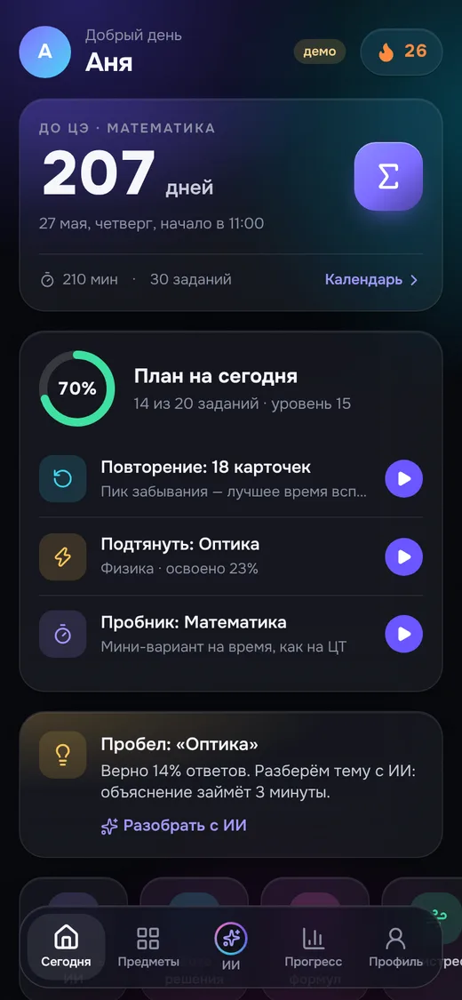
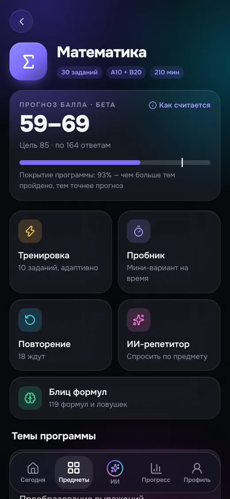
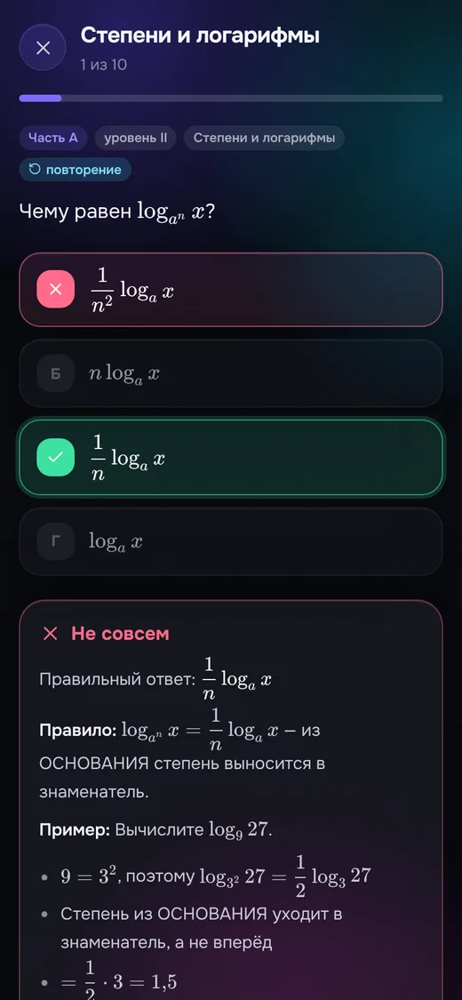
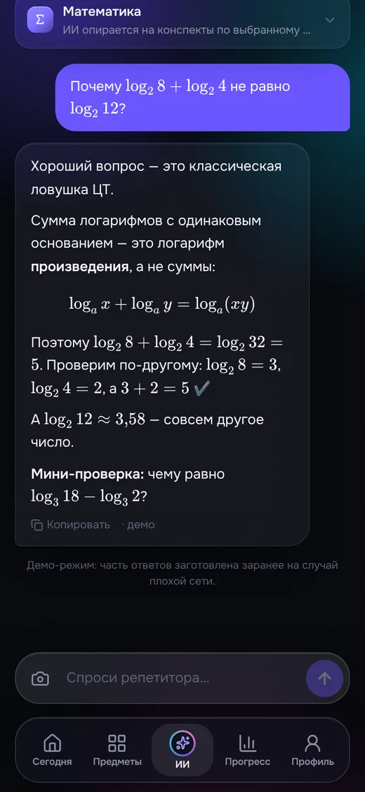
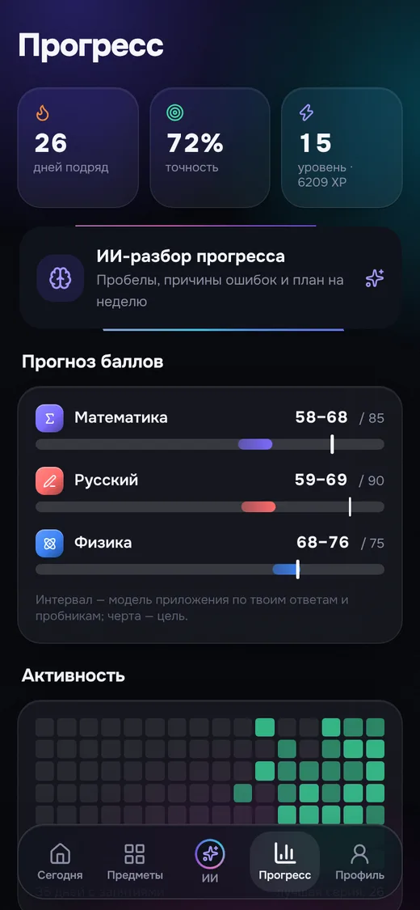
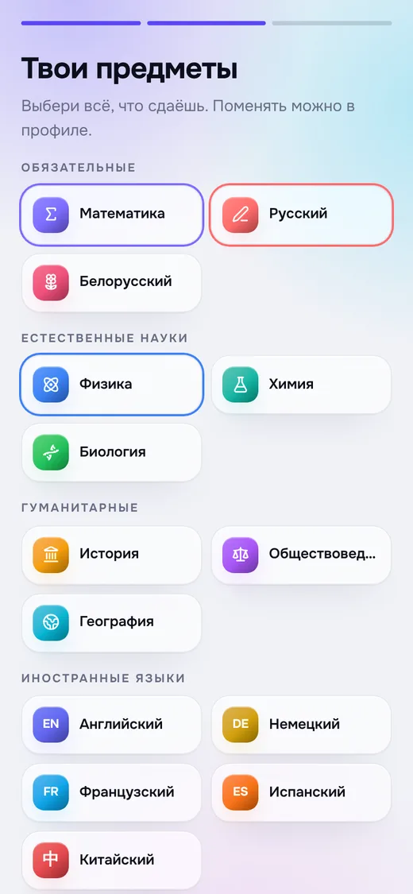
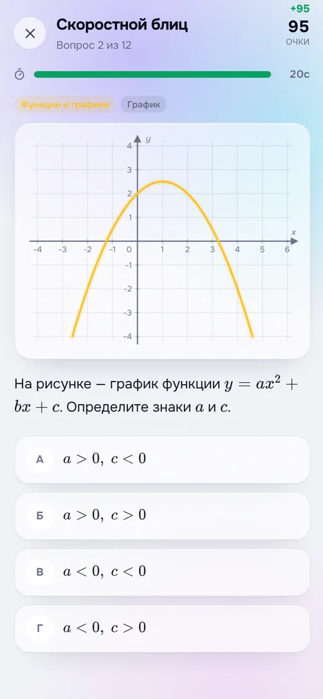
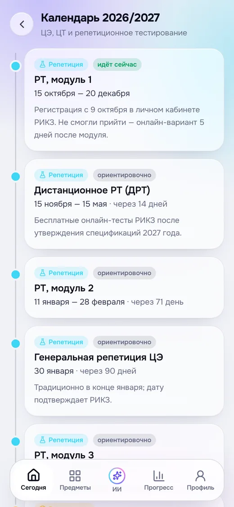

# Крок — ИИ-подготовка к ЦЭ и ЦТ в Telegram

**Крок** (по-белорусски — «шаг») — мини-приложение Telegram для подготовки к
централизованному экзамену (ЦЭ) и централизованному тестированию (ЦТ) в
Беларуси. Все 14 предметов, задания в формате РИКЗ, персональный
ИИ-репетитор, который подсказывает, а не решает, и повторение по алгоритму
FSRS — тому же, что в Anki.

<p>




</p>
<p>




</p>

## Что внутри

- **14 предметов** ЦЭ/ЦТ: структура тестов, даты 2027 года, средние баллы и
  стобалльники 2026, пороговые баллы — по документам Минобразования и РИКЗ.
- **116 тем** с конспектами (608 опорных фактов и ловушек), **175 собственных
  заданий** частей A и B с разборами и **119 формул** блица по математике.
- **ИИ-репетитор** в 7 режимах: объясни, Сократ, проверь решение (в том числе по
  фото), разбор ошибки, план подготовки, антистресс и свободный вопрос.
  Отвечает с опорой на конспект темы (RAG), видит эталонное решение задания.
- **Генерация заданий** по любой теме и **ИИ-разбор прогресса** с планом на неделю.
- **Наука об обучении**: интервальное повторение FSRS, чередование тем,
  самопроверка, классификация причин ошибок, прогноз балла по темам спецификации.
- **Пробник** в формате ЦТ на время, **календарь** РТ/ЦЭ/ЦТ, **библиотека**
  официальных источников (учебники e-padruchnik, спецификации, ДРТ).
- **Антистресс**: дыхание 4–6, переоценка волнения, выписывание тревог,
  чек-лист дня экзамена, контакты помощи.
- **Telegram-бот**: открывает приложение, отвечает на вопросы в чате,
  напоминает позаниматься, если сегодня ещё не было занятий.
- **Дизайн**: стекло, «аврора» на фоне, пружинные переходы, анимированные
  кольца и числа, тактильный отклик, тема Telegram (светлая/тёмная),
  полноэкранный режим, лёгкий режим для слабых телефонов.
- **Офлайн и приватность**: банк заданий и аналитика работают без сети;
  прогресс синхронизируется через облако Telegram; ключей ИИ в приложении нет.
- **Демо-профиль** для защиты проекта и заготовленные ответы на случай плохой сети.

## Документация

| Документ | О чём |
|---|---|
| [docs/ИССЛЕДОВАНИЕ.md](docs/ИССЛЕДОВАНИЕ.md) | Правила и даты ЦЭ/ЦТ, структура тестов, статистика, источники, наука об обучении, выбор нейросети |
| [docs/ИИ.md](docs/ИИ.md) | Модели и цепочка провайдеров, промпты, RAG, прогноз, безопасность, стоимость |
| [docs/АРХИТЕКТУРА.md](docs/АРХИТЕКТУРА.md) | Схема системы, модули, дизайн-система, производительность, тесты |
| [docs/ДЕПЛОЙ.md](docs/ДЕПЛОЙ.md) | Запуск в Telegram за 20 минут: бот, Cloudflare, секреты, чек-лист к защите |
| [docs/ЗАЩИТА.md](docs/ЗАЩИТА.md) | Структура выступления, сценарий демо, ответы жюри, дорожная карта |
| [docs/ВЫБОР-МОДЕЛИ.md](docs/ВЫБОР-МОДЕЛИ.md) | Какую бесплатную нейросеть выбрать: сравнение, лимиты, доступность из Беларуси |
| [docs/ПРОБНЫЙ-ВАРИАНТ.md](docs/ПРОБНЫЙ-ВАРИАНТ.md) | Проверка ИИ на варианте с намеренными ошибками: что работает, что исправили |

## Быстрый старт

```bash
npm install
npm run dev          # интерфейс: http://localhost:5173
npm test             # 65 тестов, включая проверку всего банка заданий
npm run build:pwa    # продакшен-сборка с офлайн-кэшем
```

Сервер (Cloudflare Worker: раздача приложения, ИИ, бот, напоминания):

```bash
npm run worker:install
npm run worker:test  # 46 тестов: подпись Telegram, SSE, промпты, цепочка моделей, скрипты деплоя
npm run worker:dev   # локально с заглушкой ИИ (см. worker/.dev.vars.example)
npm run worker:deploy
```

Без компьютера: два токена в секреты GitHub и кнопка **Deploy to Cloudflare** в Actions —
пошагово в [docs/ДЕПЛОЙ.md](docs/ДЕПЛОЙ.md).

## Стек

- **Клиент:** React 19, TypeScript (strict), Vite 8, Tailwind CSS v4, motion,
  zustand, ts-fsrs, KaTeX (ленивая загрузка), шрифт Onest, Telegram Mini Apps API.
- **Сервер:** Cloudflare Workers (статика + API + вебхук + cron), Workers AI
  (Qwen 3.8 — текст и фото, gpt-oss-120b, Llama 4 Scout; перепроверка заданий второй моделью),
  опционально Gemini и любой OpenAI-совместимый API, D1 (SQLite).
- **Качество:** vitest, oxlint, GitHub Actions (CI, деплой на Cloudflare,
  GitHub Pages, сборка iOS).

## Структура

```
src/
  domain/      предметы, календарь 2026/27, источники
  content/     темы, конспекты и задания по 14 предметам
  lib/         состояние, FSRS, практика, аналитика, RAG, клиент ИИ, Telegram, синхронизация
  nav/         стековая навигация и таб-бар
  ui/          дизайн-система, Markdown + LaTeX, карточка задания, графики
  screens/     экраны приложения
  data/        банк блица по математике (119 формул)
worker/
  src/         воркер: API, провайдеры ИИ, промпты, бот, напоминания, лимиты
  migrations/  схема D1
docs/          исследование, архитектура, ИИ, деплой, защита
```

## Добавить задание или тему

Откройте `src/content/<предмет>.ts`. Тема — объект с конспектом (`summary`,
`facts`, `traps`): по нему же работает поиск для ИИ. Задание части A — `a(id,
тема, уровень, условие, [верный, …неверные], разбор)`; верный вариант пишется
первым, на экране варианты перемешиваются. Часть B — `b(id, тема, уровень,
условие, [допустимые ответы], разбор)`. `npm test` проверит формат, ответы,
формулы и уникальность id.

## Другие способы установки

Приложение остаётся обычным веб-приложением, поэтому работает и вне Telegram:

- **PWA** — `pages.yml` публикует сборку на GitHub Pages; в Safari:
  «Поделиться» → «На экран Домой». Обновления применяются по кнопке, чтобы не
  прерывать тренировку. Для ИИ задайте переменную `KROK_API_BASE`.
- **iOS (IPA для Sideloadly)** — workflow «Build iOS IPA (unsigned)» собирает
  приложение через Capacitor 8 без сертификатов Apple; подпись — своим Apple ID
  в Sideloadly (7 дней для бесплатного аккаунта). Bundle ID `by.ctmath.blitz`.

Прогресс блица из прежней версии приложения сохраняется: он хранится под тем
же ключом localStorage.

## Важно

- Даты и структура тестов меняются: перед экзаменационным годом сверяйте
  `src/domain/subjects.ts` и `src/domain/calendar.ts` со спецификациями РИКЗ.
- Учебники и тесты РИКЗ защищены авторским правом — приложение ссылается на
  первоисточники, а задания и конспекты в нём собственные.
- ИИ может ошибаться; в интерфейсе об этом сказано, а ответы опираются на
  проверенные конспекты.
