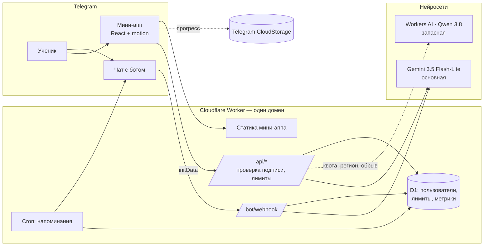

# Архитектура «Крока»

## Принципы

1. **Офлайн-первый клиент.** Банк заданий, конспекты, аналитика, FSRS и прогноз
   работают на устройстве. Сеть нужна только ИИ. Прогресс лежит в localStorage
   и синхронизируется между устройствами через Telegram CloudStorage — без своей
   базы пользователей и без регистрации.
2. **Ни одного ключа в бандле.** Ключи нейросетей и токен бота живут в секретах
   воркера. Клиент доказывает, кто он, подписью Telegram (initData, HMAC-SHA256).
3. **Промпты — на сервере.** Клиент присылает режим и данные; инструкции модели
   собираются воркером и не могут быть подменены.
4. **Устойчивость к сбоям.** Цепочка провайдеров с переключением до первого
   токена; демо-режим с заготовленными ответами на случай плохой сети на защите.
5. **Один домен.** Воркер раздаёт и мини-апп, и API — нет CORS, Telegram
   открывает приложение мгновенно. Версия на GitHub Pages тоже работает (PWA).

## Фронтенд (`src/`)

| Путь | Что внутри |
|---|---|
| `domain/` | Справочники: 14 предметов (формат тестов, даты, пороги, статистика), календарь 2026/27, источники |
| `content/` | Темы, конспекты и задания по каждому предмету; грузятся отдельными чанками |
| `lib/store.ts` | Состояние (zustand): профиль, прогресс, чат, настройки; сохранение и демо-режим |
| `lib/srs.ts` | Интервальное повторение FSRS (`ts-fsrs`), оценка ответа по поведению |
| `lib/practice.ts` | Проверка ответов (числа, «А1Б3В2», латиница/кириллица), очередь тренировки, пробник |
| `lib/analytics.ts` | Освоение тем с забыванием, прогноз балла, ошибки, тепловая карта, уровни |
| `lib/retrieval.ts` | BM25-поиск по конспектам для RAG |
| `lib/ai.ts` | Клиент воркера: SSE-стрим, генерация, разбор; проверка ответов модели |
| `lib/lesson.ts` | «Объясни»: границы разбора темы в чате |
| `lib/account.ts` | Аккаунт = Telegram: заголовок авторизации (initData в мини-аппе, токен сессии на сайте), вход через бота, выход |
| `lib/sync.ts` | Синхронизация прогресса: облако Telegram и аккаунт на сервере, побеждает более свежий снимок; сразу после входа — прогресс аккаунта |
| `ui/Account.tsx` | Блок «Аккаунт» в профиле и шторка входа с кодом |
| `lib/telegram.ts` | Mini Apps API: тема, безопасные зоны, haptics, BackButton, CloudStorage, fullscreen |
| `lib/sync.ts` | Синхронизация через CloudStorage (куски по 4000 символов) |
| `nav/` | Стековая навигация по вкладкам, интеграция с кнопкой «Назад» Telegram |
| `ui/` | Дизайн-система: стекло, кнопки, кольца прогресса, шторки, тосты, Markdown + KaTeX |
| `screens/` | Экраны: онбординг, «Сегодня», предметы, тема, тренировка, пробник, ИИ (с разбором темы «Объясни»), задания от ИИ, прогресс, профиль, библиотека, календарь, антистресс, блиц |

### Дизайн-система

- Цвета — CSS-переменные, переключаемые атрибутом `data-theme`; Tailwind v4
  утилиты (`bg-surface`, `text-fg`, `border-line`) работают в обеих темах.
- «Стекло»: `backdrop-filter: blur() saturate()` + полупрозрачная заливка +
  световой блик сверху. На слабых Android (Telegram сообщает класс устройства
  в User-Agent) включается «лёгкий режим» без размытия.
- Анимации — библиотека `motion`: пружинные переходы между экранами с учётом
  направления, общий «пилюльный» индикатор вкладок (`layoutId`), каскадное
  появление карточек, анимированные числа и кольца, шторки со свайпом.
  Анимируется только `transform`/`opacity`; на предках стекла — только
  `transform` (анимация прозрачности ломает `backdrop-filter`).
- `prefers-reduced-motion` отключает декоративные анимации.
- Шрифт Onest (кириллица) — локально, без внешних запросов.

### Производительность

- Первый экран: ~100 КБ gzip JS + ~70 КБ анимаций; KaTeX (~78 КБ) догружается
  в фоне; контент предметов — отдельными чанками по 2–8 КБ gzip.
- Сервис-воркер кэширует сборку для офлайна (без устаревших форматов шрифтов).

## Воркер (`worker/`)

| Путь | Что внутри |
|---|---|
| `src/index.ts` | Маршрутизация: `/api/*`, `/bot/webhook`, статика; CORS; cron |
| `src/telegram.ts` | Проверка initData (HMAC, сравнение за постоянное время, срок жизни), Bot API |
| `src/api.ts` | `chat` (SSE), `generate`, `analyze`, `me`, `status`, `state` (прогресс в аккаунте), `auth/*` (вход на сайте); валидация и обрезка входа |
| `src/account.ts` | Вход через бота (одноразовый запрос + код, подтверждение кнопкой в чате, токен выдаётся один раз), сессии (на сервере — только хэш токена), снимок прогресса |
| `src/ai/providers.ts` | Gemini, Workers AI, OpenAI-совместимые, заглушка; переключение до первого токена и посреди ответа |
| `src/ai/prompts.ts` | Системные промпты по режимам (только ЦЭ/ЦТ, для выпускников), генерация заданий, разбор прогресса |
| `src/ai/verify.ts` | Отсев заданий (формат, «рассуждения вслух», ключа нет в решении) и перепроверка: другая модель решает вслепую, расходящиеся отбрасываются |
| `src/ai/sse.ts` | Разбор SSE трёх форматов, вырезание `<think>`, «терпимый» JSON |
| `src/limits.ts` | Дневные лимиты (атомарный UPSERT в D1), обезличенные метрики |
| `src/bot.ts` | Команды /start, /help, /remind, /stats; ответы ИИ прямо в чате |
| `src/cron.ts` | Напоминания в выбранный час в часовом поясе ученика, только если сегодня не занимался |
| `migrations/` | Схема D1 |
| `node/platform.mjs`, `node/server.mjs` | Тот же воркер на своём сервере: SQLite вместо D1, Workers AI по REST, раздача статики, расписание. Образ — `Dockerfile`, HTTPS — `deploy/` (Caddy) |

## Безопасность и приватность

- initData проверяется на каждом запросе к ИИ; срок жизни — сутки.
- Лимиты на пользователя; гости сайта без Telegram (если включены) — по IP, вдвое
  строже, и все вместе не больше общего дневного потолка, чтобы ученикам в боте
  всегда хватало ИИ.
- Размер запроса, длина сообщений, число ссылок и размер фото ограничены.
- Ответы ИИ рендерятся без `innerHTML`; формулы — KaTeX с `trust: false`.
- Аккаунт = Telegram, паролей нет. На сайте вход через бота: сайт и бот показывают
  один и тот же код, вход подтверждается кнопкой в чате — чужая ссылка не войдёт в
  аккаунт незаметно. Токен сессии выдаётся один раз, на сервере хранится только его
  SHA-256; запрос входа живёт 10 минут, попыток входа с одного IP — 30 в день.
- Прогресс в аккаунте (`user_state`) — снимок без чата и фото, до 1,5 МБ.
- В D1 хранятся только Telegram ID, имя, настройки напоминаний и счётчики.
  Ответы на задания, чат и фото на сервере не сохраняются.
- Вебхук бота принимает запросы только с секретным заголовком.

## Тесты

- `npm test` — 75 тестов: проверка ответов, очередь, FSRS, серии, прогноз, RAG,
  Markdown, валидация ответов ИИ, перевод старых профилей 9–10 класса в 11 и
  **автоматическая проверка всего банка заданий** (уникальность id, корректные
  ответы, парные `$`, потерянные `\`).
- `npm run worker:test` — 92 теста: подпись Telegram (подделка, чужой токен,
  просрочка), разбор SSE, вырезание `<think>`, промпты (только выпускники и ЦЭ/ЦТ,
  без воды), часовые пояса и скрипты деплоя, переключение моделей с причинами
  отказа и повтором при перегрузке, смена модели посреди ответа без потери
  контекста, отсев и перепроверка заданий (ключ в решении, единицы, LaTeX без
  экранирования), лимиты гостей сайта, корректность проверок пробного варианта и
  запуск на своём сервере (SQLite с настоящим кодом лимитов, Workers AI по REST,
  раздача статики без выхода из папки, поток SSE через node:http, защита от
  подмены IP).
- Проверка Docker-образа (`worker/scripts/container-check.mjs`) — перед каждой
  выкладкой на свой сервер: приложение, файлы сборки, API, поток ответа ИИ.
- Сквозной тест (`worker/scripts/e2e.mjs`) — путь ученика в настоящем браузере
  «как из Telegram»: вопрос ИИ, фото решения, разбор ошибки, со скриншотами.
- Пробный вариант (`worker/scripts/ai-eval.mjs`) — проверка качества ИИ на живом
  приложении: разбор семи ошибок разных типов, проверка по фото, сократический
  режим, безопасность, разбор темы «Объясни» по названию и по фото параграфа.
  «Фото» — снимки страниц
  `worker/scripts/eval/*.html`. Итоги — в [ПРОБНЫЙ-ВАРИАНТ.md](ПРОБНЫЙ-ВАРИАНТ.md).
- CI на GitHub Actions: типы, линтер, тесты, сборка — на каждый пуш.
